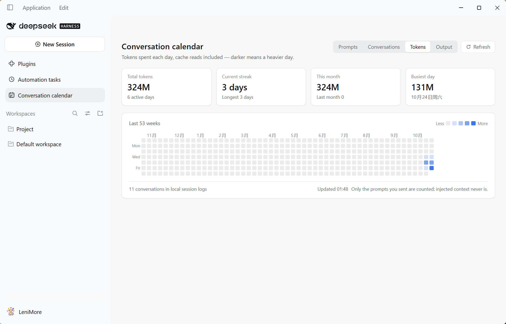
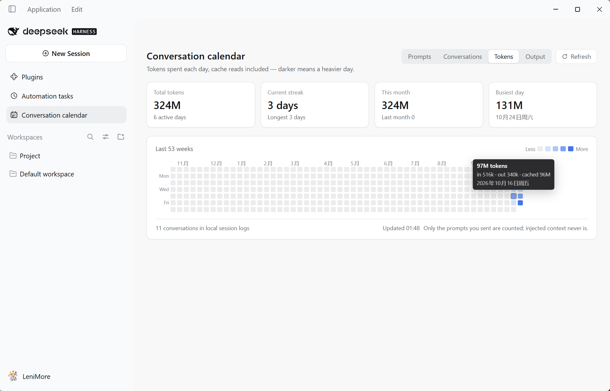

# dsh-conv-calendar

**English** | [中文](README.zh-CN.md)

A GitHub-style contribution calendar for [DeepSeek Harness](https://github.com/deepseek-ai/deepseek-harness) — see how many prompts you sent, how many conversations you had, and how many tokens you burned, one square per day.

<!--
  Screenshots — taken with the UI language set to English.
  Drop the two images into `docs/screenshots/en/` (see `docs/screenshots/README.md`).
  Until they exist these blocks render as alt text only.
-->



---

## Features

- **A sidebar entry.** *Conversation calendar* appears in the Web GUI sidebar; clicking it opens a full-page calendar.
- **GitHub-style grid.** The last 53 weeks, weeks starting Monday, five shades, one square per local day.
- **Four metrics.** Switch between **Prompts**, **Conversations**, **Tokens** and **Output**:

  | Metric | What one square means |
  | --- | --- |
  | Prompts | How many messages you sent that day |
  | Conversations | How many sessions were active that day |
  | Tokens | Total tokens spent that day (input + output + cache reads) |
  | Output | Tokens the model produced that day |

- **Four stat cards.** Total (with active days), current streak (with longest), this month (with last month), busiest day — all of them follow the selected metric.
- **Token breakdown.** Under **Tokens** / **Output**, hovering a square also shows `in · out · cached`.
- **Theme-aware.** Colors come from DSH theme variables, so light and dark mode both look native.
- **Bilingual.** Follows the UI language (English / Chinese).

## Requirements

- DeepSeek Harness **0.2.1-rc.2** or a compatible build (it relies on the `sidebar.panellist` and `main` slots, and on `ctx.sessionQuery`).
- Node **22.15+** on the Host side (the session logs are zstd-compressed).

## Install

```sh
# From a local checkout 
dsh plugin --profile desktop add link:/absolute/path/to/dsh-conv-calendar

# From npm (Recommend)
dsh plugin --profile web add dsh-conv-calendar
```

Then **restart DeepSeek Harness**. Plugins are composed from the profile's bundle list at startup, so a restart is required — the entry cannot hot-load into a running Host.

After the restart:

1. A *Conversation calendar* icon appears in the sidebar;
2. Opening it shows history already filled in, and today's square darkens as you send new messages.

To uninstall:

```sh
dsh plugin --profile desktop remove dsh-conv-calendar
```

> If a plugin ever prevents the app from starting, remove the `"dsh-conv-calendar"` line from `dsh.profile.bundles` in `$DSH_HOME/profiles/<name>/package.json` instead of using the recovery dialog, which also resets unrelated settings.

## What gets counted

### Prompts

A message counts only when all three hold:

1. the session event is `user/message`;
2. `data.source.kind === 'user'` — i.e. **you** sent it. Injected context (runtime context, skill catalog, time context, tool reminders …) carries its own source and is never counted;
3. it falls on a given day in the **machine's local time zone**.

### Tokens

Taken from `data.usage` on `assistant/message` events:

| Field | Meaning |
| --- | --- |
| `inputTokens` | Input tokens that missed the cache |
| `outputTokens` | Tokens the model produced |
| `cacheReadTokens` | Input tokens served from the cache |
| `totalTokens` | Sum of the three (provider-reported; summed locally when absent) |

Older log entries may omit `cacheReadTokens` (treated as `0`); replies with no `usage` at all are skipped.

### Cross-session de-duplication

Forking a session copies its ancestor's log. A copied prompt or reply keeps the same `message.id`, so hashing it lands in the same set and is counted once. That also makes re-reading a log idempotent — re-scanning can never double count.

> **Active days can differ per metric.** A day where the model replied but you sent nothing counts under *Tokens* but not under *Prompts*. That is intended.

## Where the data comes from

| Source | Used for | Notes |
| --- | --- | --- |
| `session/event` feed | Live counting | Every new message, and every reply carrying `usage`, is recorded immediately — no waiting for a disk flush |
| `ctx.sessionQuery` (`listSessions` / `readSession`) | Backfill | History is read through the Host's own decoder: the logs are appended frame by frame, so a single whole-file `zstdDecompressSync` only yields the first frame |

A finished session is read once and marked `final`; it is never re-read. A session that is still live is re-read on every refresh and **merged** (union of hashes, so it is idempotent). One backfill pass has an 8-second budget — leftovers resume on the next pass.

### State file

`$DSH_HOME/plugins/dsh-conv-calendar/state.json`, written atomically (temp file + rename):

```json
{
  "version": 2,
  "sessions": {
    "session-…": {
      "days": {
        "2026-10-23": {
          "prompts": ["<message-hash>"],
          "replies": { "<reply-hash>": { "input": 10395, "output": 133, "cache": 896, "total": 11424 } }
        }
      },
      "final": true
    }
  }
}
```

`version` is the store layout: `1` kept a bare array of prompt hashes per day, `2` adds `replies`. An incompatible version is **dropped and fully re-read** — the file is only a cache, so one pass rebuilds it.

Deleting the file clears the statistics; they are rebuilt from the session logs on the next start.

## HTTP endpoint

The panel reads one read-only endpoint from the same Host process:

```
GET /dsh-conv-calendar/api/summary            # current aggregate (kicks off a background backfill if needed)
GET /dsh-conv-calendar/api/summary?refresh=1  # backfill now (the panel's Refresh button)
```

The response is JSON:

- `days[]` — `{ day, messages, sessions, replies, input, output, cache, total }`
- `meta` — `sessions`, `activeDays`, `totalMessages`, `totalReplies`, `totalInput`, `totalOutput`, `totalCache`, `totalTokens`, `updatedAt`
- `history` — the last backfill report (`available`, `read`, `cached`, `failed`, `partial`)
- `historyPending` — whether a backfill is currently running

The endpoint uses the Host's connection fence (`ctx.connection.requestRejection`): a request without the session cookie gets `401`, so a loopback-only deployment never exposes the numbers.

## How it is built

```
dsh-conv-calendar/
├─ package.json          # dsh.bundle.patch + dsh.client (platform: web, inject: …)
├─ cordis.patch.yml      # inserts one row into the profile's config tree
├─ lib/
│  ├─ index.js           # Host half: counting, backfill, HTTP endpoint
│  └─ client.js          # Browser half: a hand-written factory bundle (no bundler)
├─ tests/                # offline tests, see below
└─ docs/screenshots/     # README images: en/ for this file, zh-CN/ for the Chinese one
```

**No build step.** The browser half is written directly in the platform's factory form: `window.__ModuleLoader__.load({ id, factory })` registers a factory, and the module body runs on first use. `react` is resolved from the Host's shared module table.

Two slot contributions, both declaration-aware:

```js
ctx.slots.inject('sidebar.panellist', () => ctx.slots.register({ name: 'sidebar.panellist', id: PANEL_ID, order: 20, label: () => t('panel.label'), locale: NS }, CalendarGlyph))
ctx.slots.inject('main', () => ctx.slots.register({ name: 'main', key: PANEL_ID, locale: NS }, CalendarPanel))
```

`ctx.slots.inject(name, …)` is deliberate rather than a bare `ctx.slots.register(...)`: a slot's declaration may arrive *after* this plugin, and registering into an undeclared key throws — which the shell surfaces as an entry that "did not activate". `inject` defers the registration until the declaration exists and re-runs it if the contributing package is replaced.

### Two Host-side details worth knowing

- **The Loader does not read a function plugin's namespace-level `inject` export.** A function plugin (as opposed to a class plugin) must reach the service imperatively, so the Host half uses `ctx.inject(['webServer'], (inner) => …)`.
- **Client bundles must declare their dependencies** in `package.json` → `dsh.client.inject`. Without it the module graph treats the bundle as dependency-free, may activate it before `ui-renderer` / `ui-layout` / `client-locale`, and the whole app refuses to start.

## Tests

`tests/` holds the offline tests. They need their own dependencies, declared in `tests/package.json`:

```sh
cd tests
npm install
npm test        # runs all five
```

Run one on its own with `node token-fold.mjs`, and so on.

| Test | Needs | What it asserts |
| --- | --- | --- |
| `token-fold.mjs` | nothing (Node only) | Folds the real session logs and compares every day's input/output/cache/total against an independent pass; legacy v1 days still read; re-recording is idempotent; usage without `cacheReadTokens` normalizes to 0 |
| `host-contract.mjs` | cordis | Mounts the Host half in the real cordis runtime with stubbed `webServer` / `sessionQuery`: route registration, injected messages ignored, finished sessions read once, live prompts and reply usage recorded immediately, replies without usage contributing nothing, `HEAD`/`POST` handling, route removal on dispose |
| `panel-render.mjs` | react, jsdom | 371 cells, month labels, tooltip, metric switching, refresh going through `?refresh=1` |
| `panel-states.mjs` | react, jsdom | Empty data still draws the grid plus a hint, failure state offers retry, English copy uses correct singular/plural |
| `panel-token.mjs` | react, jsdom | Token and Output metrics, `496k` / `16k` formatting, the token breakdown in the tooltip, and that the four metrics shade the grid differently |

`module-system-emulation.mjs`, `shell-emulation.mjs` and `slots-probe.mjs` are the diagnostic scripts used to trace the boot failure described above; they are kept as documentation of the investigation and are not part of `npm test`.

End-to-end verification performed during development: a second Host booted from a temporary profile returned 6 days / 10 sessions / 62 prompts / **253M tokens** from real logs, with each day's input/output/cache matching an independent script exactly; the panel rendered that live payload in jsdom, producing four distinct heatmap patterns, with the token tooltip showing the input/output/cache split; a cookie-less request was refused with `401`.

## Limitations

- **Backfill needs `sessionQuery`.** In a composition without it, only the current run is counted and the footer says so.
- **Finished sessions are never re-read.** That is safe because a finished log cannot change; if you rewrite history by hand, delete `state.json`.
- **Only human messages count.** Injected context never does — that is the point.
- **The time zone is the machine's, read at startup.** After travelling, old dates stay filed under the local date they happened on.

## License

[MIT](LICENSE)
