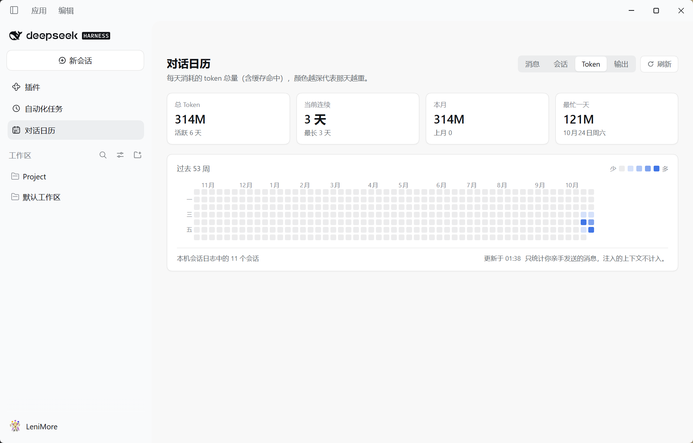
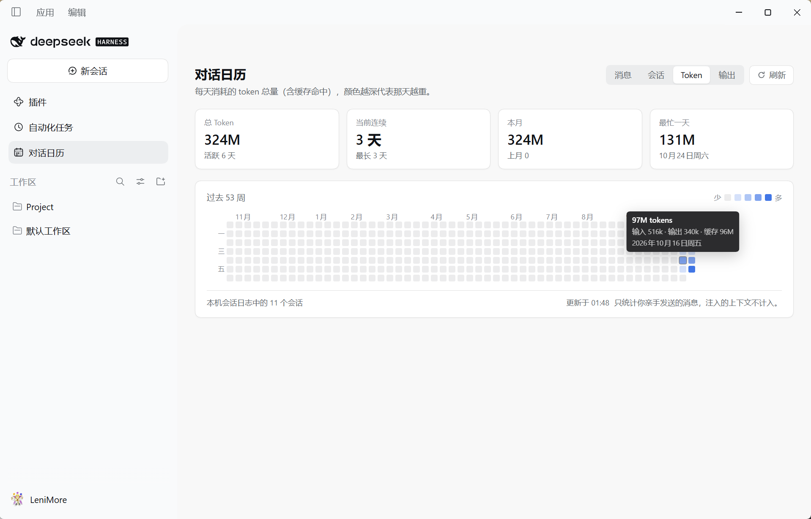

# dsh-conv-calendar · 对话日历

[English](README.md) | **中文**

给 [DeepSeek Harness](https://github.com/deepseek-ai/deepseek-harness) 用的 GitHub 风格提交日历 —— 每天发了多少条对话、开了几个会话、烧了多少 token，一格一天，一眼看完。

<!--
  截图 —— 界面语言设为中文时拍摄。
  把两张图放进 `docs/screenshots/zh-CN/`（怎么截见 `docs/screenshots/README.md`）。
  放好之前这里只显示替代文本。
-->



---

## 功能

- **侧边栏入口**：Web 界面左侧栏出现「对话日历」图标，点开即是整页日历。
- **GitHub 风格网格**：过去 53 周，周一起始，5 级配色，一格一个本地日期。
- **四个指标**：「消息 / 会话 / Token / 输出」随时切换。

  | 指标 | 一格代表什么 |
  | --- | --- |
  | 消息 | 当天你发出的消息条数 |
  | 会话 | 当天活跃的会话个数 |
  | Token | 当天消耗的 token 总量（输入 + 输出 + 缓存命中） |
  | 输出 | 当天模型产出的 token 数 |

- **四个数字**：总量（含活跃天数）、当前连续（含历史最长）、本月（含上月对比）、最忙一天 —— 全部随指标切换。
- **Token 明细**：Token / 输出模式下，悬停格子还会显示 `输入 · 输出 · 缓存` 拆分。
- **深浅色自适应**：颜色取自 DSH 主题变量，不写死配色，亮色深色都像原生。
- **中英双语**：跟随界面语言。

## 环境要求

- DeepSeek Harness **0.2.1-rc.2** 或兼容版本（依赖 `sidebar.panellist` 与 `main` 槽位，以及 `ctx.sessionQuery`）。
- 宿主侧 Node **22.15+**（会话日志是 zstd 压缩的）。

## 安装

```sh
# 本地目录安装
dsh plugin --profile desktop add link:/绝对路径/dsh-conv-calendar

# 从 npm 安装（推荐）
dsh plugin --profile desktop add dsh-conv-calendar
```

然后**重启 DeepSeek Harness**。插件是在启动时按 profile 的 bundle 列表装配的，无法热加载进正在运行的宿主。

重启后：

1. 左侧栏出现「对话日历」图标；
2. 点开时历史数据已经填好，当天格子会随新消息实时变深。

卸载：

```sh
dsh plugin --profile desktop remove dsh-conv-calendar
```

> 万一某个插件导致应用起不来，请到 `$DSH_HOME/profiles/<名字>/package.json` 的 `dsh.profile.bundles` 里删掉 `"dsh-conv-calendar"` 那一行 —— 不要用恢复对话框，它会连带把你的其他设置一并重置。

## 计数口径

### 消息

三个条件都成立才计数：

1. 会话事件类型是 `user/message`；
2. `data.source.kind === 'user'`，即**你亲手发出的**。注入的上下文（运行上下文、技能清单、时间上下文、工具提醒……）各有自己的 source，永远不计；
3. 按**本机本地时区**归到某一天。

### Token

来自 `assistant/message` 事件的 `data.usage`：

| 字段 | 含义 |
| --- | --- |
| `inputTokens` | 未命中缓存的输入 token |
| `outputTokens` | 模型产出的 token |
| `cacheReadTokens` | 命中缓存的输入 token |
| `totalTokens` | 三者之和（provider 报告值；缺失时本地相加） |

较早的日志可能没有 `cacheReadTokens`，按 `0` 处理；完全没有 `usage` 的回复直接跳过。

### 跨会话去重

会话被 fork 时会复制祖先的日志。复制过来的 prompt 和 reply 保持相同的 `message.id`，哈希后落在同一个集合里，所以只算一次。这也让重复读取日志成为幂等操作 —— 重新扫描永远不会重复计数。

> **活跃天数会随指标变化。** 某天只有模型回复、你没有发消息，它在「Token」里算活跃、在「消息」里不算。这是刻意的。

## 数据来源

| 来源 | 用途 | 说明 |
| --- | --- | --- |
| `session/event` 事件流 | 实时计数 | 每条新消息、每条带 `usage` 的回复立刻入账，不等写盘 |
| `ctx.sessionQuery`（`listSessions` / `readSession`） | 历史回填 | 历史走宿主自己的解码器：日志是逐帧追加的，单次整体 `zstdDecompressSync` 只能解出第一帧 |

已结束的会话只读一次并打上 `final`，之后不再重读；仍在运行的会话每次刷新都会重读并**合并**（哈希取并集，天然幂等）。一次回填有 8 秒预算，超时留下的部分下次继续。

### 状态文件

`$DSH_HOME/plugins/dsh-conv-calendar/state.json`，原子写入（临时文件 + rename）：

```json
{
  "version": 2,
  "sessions": {
    "session-…": {
      "days": {
        "2026-10-23": {
          "prompts": ["<message-hash>"],
          "replies": { "<reply-hash>": { "input": 10395, "output": 133, "cache": 896, "total": 11424 } }
        }
      },
      "final": true
    }
  }
}
```

`version` 是存储布局版本：`1` 的每天只是一个 prompt 哈希数组，`2` 才有 `replies`。遇到不兼容版本会**丢弃并全量重读** —— 这个文件只是缓存，重读一次就重建好了。

删除该文件即清空统计，下次启动会从会话日志重新回填。

## HTTP 接口

面板读同一个宿主进程里的一个只读接口：

```
GET /dsh-conv-calendar/api/summary            # 当前聚合结果（需要时启动一次后台回填）
GET /dsh-conv-calendar/api/summary?refresh=1  # 立即回填（面板上的「刷新」按钮）
```

响应是 JSON：

- `days[]` —— `{ day, messages, sessions, replies, input, output, cache, total }`
- `meta` —— `sessions`、`activeDays`、`totalMessages`、`totalReplies`、`totalInput`、`totalOutput`、`totalCache`、`totalTokens`、`updatedAt`
- `history` —— 最近一次回填的报告（`available`、`read`、`cached`、`failed`、`partial`）
- `historyPending` —— 当前是否有回填在跑

接口沿用宿主的连接栅栏（`ctx.connection.requestRejection`）：没有会话 Cookie 的请求拿到 `401`，只监听回环地址的部署不会把数据暴露出去。

## 实现说明

```
dsh-conv-calendar/
├─ package.json          # dsh.bundle.patch + dsh.client（platform: web、inject: …）
├─ cordis.patch.yml      # 往 profile 配置树里插入一行
├─ lib/
│  ├─ index.js           # 宿主半边：计数、回填、HTTP 接口
│  └─ client.js          # 浏览器半边：手写的 factory 形式 bundle（无需打包）
├─ tests/                # 离线测试，见下文
└─ docs/screenshots/     # README 配图：en/ 给英文版，zh-CN/ 给本文件
```

**没有构建步骤。** 浏览器半边直接写成平台的 factory 形式：`window.__ModuleLoader__.load({ id, factory })` 注册一个工厂，模块体在首次使用时才执行；`react` 从宿主的共享模块表里解析。

两个槽位贡献都写成「声明感知」的形式：

```js
ctx.slots.inject('sidebar.panellist', () => ctx.slots.register({ name: 'sidebar.panellist', id: PANEL_ID, order: 20, label: () => t('panel.label'), locale: NS }, CalendarGlyph))
ctx.slots.inject('main', () => ctx.slots.register({ name: 'main', key: PANEL_ID, locale: NS }, CalendarPanel))
```

用 `ctx.slots.inject(name, …)` 而不是裸的 `ctx.slots.register(...)` 是刻意的：槽位的声明可能晚于本插件到达，而往未声明的 key 注册会抛错 —— shell 会把它显示成「条目未能激活」。`inject` 会等到声明存在再注册，贡献方被替换时也会重跑。

### 两个宿主侧的关键细节

- **Loader 不读函数插件命名空间上的 `inject` 导出。** 函数插件（相对于类插件）必须用命令式方式取服务，所以宿主半边用的是 `ctx.inject(['webServer'], (inner) => …)`。
- **浏览器 bundle 必须在 `package.json` 的 `dsh.client.inject` 里声明依赖。** 少了它，模块图会把这个 bundle 当成零依赖，可能让它早于 `ui-renderer` / `ui-layout` / `client-locale` 激活，进而导致整个应用起不来。

## 测试

`tests/` 下是离线测试，依赖写在 `tests/package.json` 里：

```sh
cd tests
npm install
npm test        # 五个一起跑
```

单个跑：`node token-fold.mjs`，其余同理。

| 测试 | 依赖 | 断言内容 |
| --- | --- | --- |
| `token-fold.mjs` | 无（纯 Node） | 折叠会话日志，逐日对比 input/output/cache/total 与独立统计。有 `$DSH_HOME/sessions` 下的真实日志时读真实日志；没有时在临时目录造一份同构 fixture（一个文件多个 zstd 帧、一个 fork 会话重复祖先事件）并断言等价总量。另外校验 v1 旧格式仍可读、重复记录幂等、缺 `cacheReadTokens` 归一为 0 |
| `host-contract.mjs` | cordis | 在真实 cordis 运行时里挂载宿主半边（桩掉 `webServer` / `sessionQuery`）：路由注册、注入消息被忽略、已结束会话只读一次、实时 prompt 与 reply usage 立即入账、无 usage 的回复不贡献 token、`HEAD`/`POST` 处理、卸载时路由回收 |
| `panel-render.mjs` | react、jsdom | 371 个格子、月份标签、悬停提示、指标切换、刷新走 `?refresh=1` |
| `panel-states.mjs` | react、jsdom | 空数据仍画出网格并给提示、失败态可重试、英文单复数正确 |
| `panel-token.mjs` | react、jsdom | Token / 输出指标、`496k` / `16k` 格式、tooltip 里的 token 拆分，以及四个指标确实会画出不同的热力图案 |

`module-system-emulation.mjs`、`shell-emulation.mjs`、`slots-probe.mjs` 是排查上面那个启动失败时用的诊断脚本，留作调查过程记录，不在 `npm test` 里。

开发期做过的端到端验证：用临时 profile 启动第二个宿主，从真实日志返回 6 天 / 10 个会话 / 62 条消息 / **253M tokens**，每天 input/output/cache 与独立脚本逐日一致；面板在 jsdom 里渲染该真实 payload，四个指标产生四种不同热力图案，token tooltip 正确显示输入/输出/缓存拆分；无 Cookie 的请求被 `401` 拒绝。

## 已知限制

- **回填依赖 `sessionQuery`**：没有挂载该服务的装配里只统计本次运行，页脚会明确提示。
- **已结束会话不重读**：日志一旦完结就不会再变，所以缓存是安全的；如果你手工改写了历史，删掉 `state.json`。
- **只统计真人消息**：注入的上下文永远不计，这是刻意的口径。
- **时区取启动时的本机时区**：跨时区旅行后，旧日期仍归档在它发生时的本地日期下。

## 许可证

[MIT](LICENSE)
